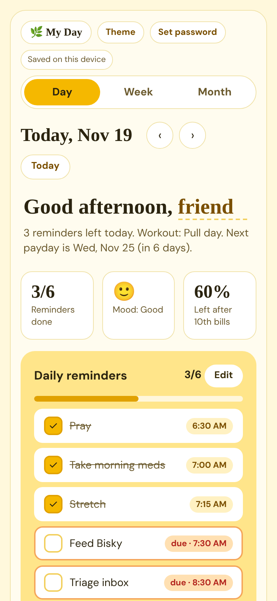
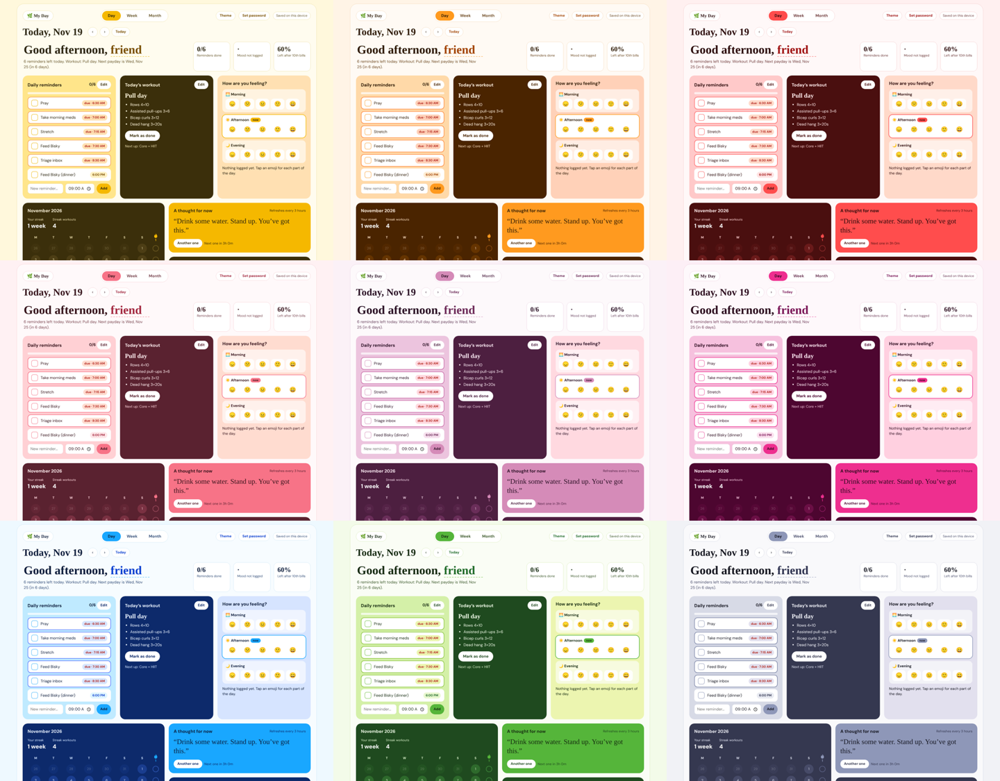
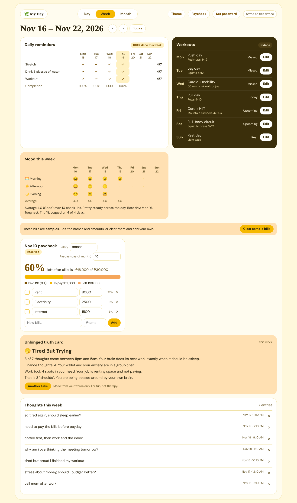

# pbb-day

**A calm, one-page planner for your day.** Reminders, money, workouts, mood and a thought dump, all in one place that opens in your browser. It's free, has no ads, and works on your phone and laptop.

<p align="center">
  
</p>

## What is it?

pbb-day is a personal dashboard made of one web page (`index.html`). Open it, tick off what you did today, log how you feel, and see how your week and month are going. There's nothing to install and nothing to pay for. Put it on your phone's Home Screen and it opens like an app.

## What can it do?

| | |
|---|---|
| **Daily reminders** | Your own checklist for the day, such as meds, stretching, feeding the pet or clearing your inbox. Each one has a time and turns "due" when it's late. |
| **Workout plan + streak** | A workout set for each weekday that shows up on its day. Mark it done and a monthly calendar fills in, with a weekly streak. |
| **Money tracker** | Two paychecks a month, with their own salary, bills and payday date. The dates start at the 10th and 25th, and you can change them any time. It shows the **% of your salary left after bills**. |
| **Mood tracker** | Tap how you feel in the morning, afternoon and evening. It shows a summary for the day, week and month. |
| **Thought dump** | Get things out of your head and find them later. |
| **Quote + focus timer** | A short motivating quote that changes every few hours, plus 15, 25 and 50 minute focus timers. |
| **Day, Week, Month** | See one day, the whole week, or the month at a glance. |
| **9 colors** | Yellow, Orange, Red, Pink, Purple, Maroon, Blue, Green and Gray. |
| **Password lock** | An optional password asked each time the page opens on that device. |
| **Share (view-only)** | With sync on, give friends a code. They press **View with code** and can look but not change anything. Money and thoughts are hidden unless you include them. |
| **Sync** | Optional Google sign-in saves your data to the cloud, so your phone and laptop match. |

<p align="center">
  
  &nbsp;&nbsp;
  
</p>

## Who is it for?

- **People who like simple routines:** one place for the small daily things.
- **People with a salary paid twice a month:** see right away how much is left after bills.
- **People building a workout habit:** a plan for each day and a streak that rewards showing up.
- **People who want to track their mood** without a heavy journaling app.
- **People managing ADHD or a busy brain:** short checklists, a thought dump and a focus timer.
- **Students and workers** who want a free planner they can fully customize.
- **Anyone who wants their own copy:** it's one file you can change and host for free.

It is not a medical or financial tool. It helps you keep track, and it doesn't give advice.

<p align="center">
  
  &nbsp;
  
</p>

---

## Option 1: Just use it

Open the link, press **Theme** to pick a color, and start. Sign in with Google to save your data to the cloud and see it on your other devices.

If you use the original link, your data is stored in the owner's Firebase project. Other users can't see it through the app, but the owner can see it in their Firebase console. If you want your data to be fully yours, use Option 2 or 3.

---

## Option 2: Your own copy, no Firebase needed

Firebase is **not required**. Without it, the page works fine but saves only in the browser on that one device. There is no sign-in and no sync between your phone and laptop. Clearing your browser's site data erases it.

1. Make a free account at github.com.
2. Open this repo and press **Fork** (top right). This copies it to your account.
3. In your copy, open `index.html`, press the pencil icon, and find the block that starts with `const FIREBASE_CONFIG={`. Change it to:
   ```js
   const FIREBASE_CONFIG={ apiKey:"", authDomain:"", projectId:"", appId:"" };
   ```
   An empty `apiKey` turns the cloud features off. Press **Commit changes**.
4. Go to your copy's **Settings → Pages**. Under "Build and deployment", choose **Deploy from a branch**, branch **main**, folder **/ (root)**, and press **Save**.
5. After a minute or two, your page is live at `https://YOUR-USERNAME.github.io/REPO-NAME/`.

If you skip step 3, your copy will still point at the original owner's Firebase. Always replace that block.

---

## Option 3: Your own copy with cloud sync (Firebase)

This gives you Google sign-in and syncing across your phone and laptop, with the data in your own account. It's free on Firebase's Spark plan.

1. Do steps 1 and 2 from Option 2. Don't change the config yet.
2. Go to **console.firebase.google.com** and sign in with a Google account.
3. Press **Create a project**, name it, and finish the wizard. Google Analytics is optional and can be off.
4. On the project home, press the **web icon `</>`** to add a web app. Give it any nickname. Don't tick "Firebase Hosting". Press **Register app**.
5. Copy the values shown in `firebaseConfig`: `apiKey`, `authDomain`, `projectId`, `appId`.
6. In `index.html` on GitHub, replace the config block with your values:
   ```js
   const FIREBASE_CONFIG={
    apiKey:"...",
    authDomain:"...",
    projectId:"...",
    appId:"..."
   };
   ```
   Press **Commit changes**.
7. In Firebase, go to **Build → Authentication → Get started → Sign-in method**, choose **Google**, turn it on, pick a support email, and **Save**.
8. Go to **Build → Firestore Database → Create database**. Pick a location near you (it can't be changed later), choose **Production mode**, and press **Create**.
9. Open the **Rules** tab in Firestore, replace everything with the rules below, and press **Publish**:
   ```
   rules_version = '2';
   service cloud.firestore {
     match /databases/{database}/documents {
       match /users/{uid}/{document=**} {
         allow read, write: if request.auth != null && request.auth.uid == uid;
       }
     }
   }
   ```
   These rules let each signed-in person read and write only their own data.
10. Go to **Authentication → Settings → Authorized domains → Add domain** and add `YOUR-USERNAME.github.io`.
11. Turn on GitHub Pages as in step 4 of Option 2. Open your page and sign in with Google.

The keys in the config are not secrets. Anyone can see them in the page. The security rules from step 9 are what protect your data.

---

## Colors

Press **Theme** at the top of the page and choose Yellow, Orange, Red, Pink, Purple, Maroon, Blue, Green or Gray. The choice is saved with your data.

To add your own color, find the `THEMES` list in `index.html`, copy one entry, give it a new name, and change its color codes.

## Password lock

Press **Set password** to ask for a password each time the page opens on that device. It's a privacy screen, not strong security.

## Sharing a view-only copy

This needs Option 3 (Firebase). Sign in, press **Share**, pick a code (6+ characters) and choose whether to show money and thoughts. After you start sharing, press **Copy link** and send it. Friends who open that link see your dashboard right away. You can also send `…/my-day/#view`, which asks them for the code as soon as it opens. They can also open the normal page, press **View with code** and type it. Nothing is remembered on their device, and they can't edit anything.

Add this to your Firestore rules, next to the `users` rule, then press Publish:

```
match /shares/{id} {
  allow get: if true;
  allow create: if request.auth != null && request.resource.data.owner == request.auth.uid;
  allow update: if request.auth != null && resource.data.owner == request.auth.uid && request.resource.data.owner == request.auth.uid;
  allow delete: if request.auth != null && resource.data.owner == request.auth.uid;
}
```

Note: anyone with the code can see what you chose to share, so use a code that is hard to guess. Press **Stop sharing** to turn it off.

## Tips

- On iPhone: open the page in Safari, then Share → **Add to Home Screen**.
- Tap **My Day** at the top left to reload the latest data.
- Reminders, bills and workouts are all editable on the page.
